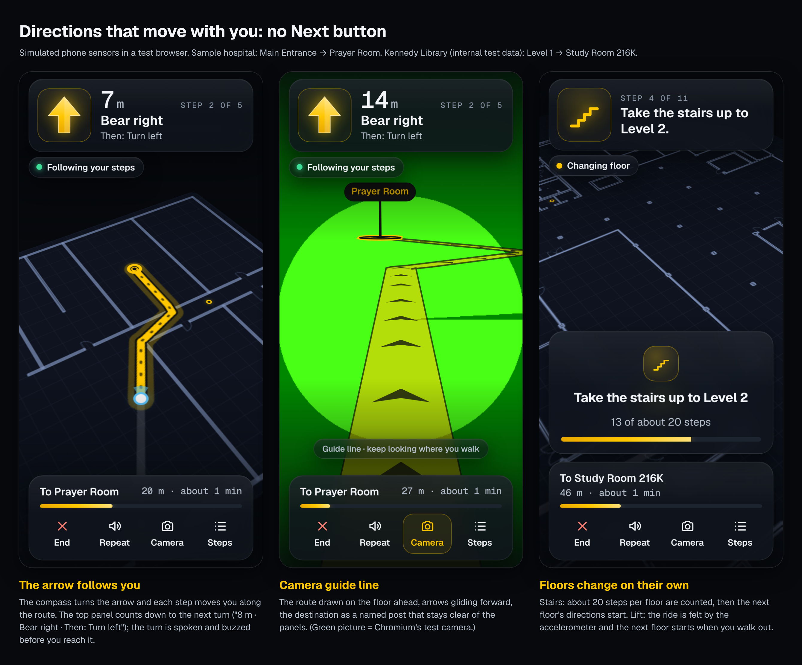

# Directions that move with you: how they work

- **Code**: `app/tracker.js` (sensors, steps, lift rides, route matching), `app/camera.js` (camera, guide line,
  QR), and the wiring in `app/app.js` (navigation section).
- **Method**: there is no GPS indoors and there are no beacons. Position comes from **dead reckoning** (compass
  plus step count), snapped to the route and corrected at DALIL signs. It is an estimate, and the app says so.
- **There is no Next button and no manual stepping.** Directions move on only when the visitor moves, or at a
  DALIL sign.

## Sensors

| What | Browser source | Notes |
|---|---|---|
| Orientation | `deviceorientationabsolute` (Android Chrome), `deviceorientation` + `webkitCompassHeading` (iPhone) | Turned into the W3C rotation matrix. The direction you face is the level direction of the screen's top edge plus the back camera, so it works with the phone flat, tilted or upright. |
| Steps | `devicemotion` → `accelerationIncludingGravity` | Smoothed magnitude minus its slow average. One step per peak: over 1.15 m/s² and at least 280 ms apart. A lone bump is ignored until a second step follows. |
| Lift rides | same signal, while standing still | Fast average (0.3 s) against slow average (6 s). If they differ by more than 0.25 m/s² for over 0.5 s, more than 1.5 s after the last step, that is the push of a lift starting or the dip of it stopping. At most one event per 3 s. |
| Permission | `DeviceOrientationEvent.requestPermission()` / `DeviceMotionEvent.requestPermission()` | Asked inside the Start tap (iPhone requires a tap). If it's denied or there are no sensors, the **motion card** appears (see below). |

Sensors and the camera need **HTTPS** (or localhost). The preview frame on claude.ai can't read phone sensors,
and the app says so there.

## From compass to floor plan

The plan's own "up" is not north. `beta` = the compass bearing of the plan's +y axis.
- **Prior**, used when the phone has an absolute compass:
  - the map's `geo.bearing` (minus `geo.declination` if the map gives it);
  - or what this phone learned on this floor in the last 30 days (`localStorage` `dalil.cal`).
- **Learned from the walk**:
  - On straight parts of the route, each step gives `beta = route direction − 90° + heading`.
  - These readings feed a running circular mean, where recent steps count most.
  - Readings 50° or more away from the estimate are set aside. Ten such readings in a row that agree with each
    other, and are not a U-turn, replace the estimate.
  - This also absorbs magnetic declination and steady magnetic disturbance from the building.
- **When the arrow goes live**: with a trusted prior, or after about 5 steps of learning. Until then the top panel
  shows the step's turn, and the status says "Walk a few steps to line up the arrow".
- **Floors**: if both maps have `geo`, the estimate turns by the difference of their bearings; otherwise it is
  learned again.

## Moving along the route

- **Step length**: each step moves you `stride × cos(angle between where you face and the route)` along the
  current leg, never backwards.
  - Stride by walking pace (Settings): slow 0.55 m, normal 0.68 m, fast 0.78 m.
  - It is re-learned at DALIL signs (distance walked ÷ steps, between 0.45 and 0.95 m).
- **Wrong way**: three steps facing more than 120° away from the route stop progress and say "Wrong way · turn around".
- **Corners**:
  - turning onto the next corridor within 6 m before a corner snaps you to it;
  - still facing the old direction holds you at the corner, and the arrow then points round it.
- **Steps move on by themselves.** The top panel counts down to the next turn ("8 m · Bear right · Then: Turn left").
  - At a turn it says "Now".
  - "In 5 m: Turn left" is spoken and buzzed before each turn, floor change and arrival.
- **DALIL signs and tags** (passing one on the route, NFC tap, QR scan):
  - within 2.5 m of the current or next leg they set the position exactly and move to the matching step;
  - anywhere else in the building they plan a new route from there.

## Floor changes (automatic)

The web has no barometer, so the app uses what it has:
- **Lift** (step-free routes): the panel says "Take the lift up to Level 2 · Step out at Level 2. The arrow carries on
  when you walk out." The next floor starts when you walk again after the ride:
  - on a step after a pause of over 4 s, once a ride has been felt;
  - on a step after a pause of over 20 s, even if no ride was felt;
  - or after more than 14 steps (lift lobby and corridor walking).
- **Stairs**: the panel counts "18 of about 20 steps". After 20 steps per floor (`STAIR_STEPS`), the next floor starts.
- **Either way**, a DALIL sign at the lift lobby or stair door confirms it exactly. Place one on every floor at
  every lift and staircase on a route.

## When motion is not available

Nothing moves on by itself, and the app says so instead of guessing. The **motion card** explains why:
- permission off: "allow it in your browser settings";
- no sensors: "open DALIL on your phone";
- the preview frame: "open DALIL from its own web address".

It offers three things:
1. **Allow motion**: asks again, inside the tap.
2. **Watch a preview**: a simulated walk along the route. The status always says
   "Preview · not your real position".
3. **Continue with signs only**: the position moves only when a DALIL sign is scanned or tapped. The camera can
   read the signs' QR codes.

Kiosk screens never use motion. Start becomes "Watch the route" (a labelled preview) with a QR code to continue
on a phone.

## Camera guide line

- **Picture**: rear camera (`getUserMedia`, `facingMode: environment`), full view, with a canvas on top.
- **Placing the line**:
  - route points ahead (up to 28 m) are placed on the floor 1.35 m below the phone;
  - they are rotated into the compass frame with `beta`, then projected with the phone's rotation matrix;
  - focal length comes from a 66° field of view across the long side of the picture and the cover scaling of the
    video;
  - parts behind the camera are clipped.
- **Drawn**:
  - a 0.6 m yellow ribbon with dark edges;
  - arrows every 1.5 m gliding forward (still with Reduce motion);
  - the destination as a ring and a post with its name, or "To Level 2" at the lift or stairs. The name never
    goes under the app's panels: it slides down the post instead.
- **Line out of view**: "The line is to your left / right", "Turn around to see the line", or "Point the camera
  at the floor ahead".
- **Sign reading**: it reads DALIL sign QR codes every 0.45 s, with `BarcodeDetector` where available (Android
  Chrome), else jsQR.
- **Without motion** the camera still opens, to read signs, and says there is no guide line without motion.
- Not offered in kiosk mode.

## Position on Earth (GPS), blended with the steps

For maps aligned to the real world (`geo`, set in the Mapper's World position step), the app also watches the
phone's location: the browser's Geolocation API, which on phones is the same fused GPS + Wi-Fi + cell position map
apps use. Code: `app/locate.js` (lat/lng → plan metres) and `fuseFix` in `app/app.js`.
- **Blend**: each fix is placed on the plan, snapped to the route, and pulls the position by how sure each side is
  (a 1-D Kalman filter): GPS by its reported accuracy, the steps by how far you walked since the last fix or sign.
- **Ignored**: fixes worse than ±30 m, and fixes farther from the route than 1.5 × their accuracy + 4 m (shown as
  a circle on the map, never used). GPS never tells the floor; floor changes stay automatic (see above).
- **No motion sensors**: GPS alone moves you along the route, and the "turn on motion" card stays away while it does.
- **Home**: the place nearest to the fix becomes "You are here" (unless you picked one), labelled "Near you · GPS ±9 m".
- **Privacy**: the position stays on the phone. Settings → "Use my location (GPS)" turns it off;
  `config.features.gps: false` turns it off for a site.
- **Expect** 3–10 m outdoors and near windows, often 10–30 m deep inside a building, varying by phone and building.
  Good alignment of the plan (two well-spread reference points) matters as much as the GPS itself.

## Accuracy: what to expect

- **Heading**: phone compasses are often 5–20° off indoors near steel and electrics. Learning from the walk removes
  the steady part; brief disturbances pass through the smoothing.
- **Distance**: step counting is usually within about 5–10% on a normal walk. It is worse when:
  - shuffling;
  - **pushing a wheelchair**: few or no detectable steps, so the position moves on at DALIL signs, and every
    decision point on step-free routes needs a sign.
- **Drift**: position drifts by a few metres per 50 m between signs. Corners and signs remove it. Place DALIL signs
  at decision points (lifts, junctions, entrances) and keep straight runs between signs under about 40 m.
- **Floor changes**: stair counts vary with staircase design (20 steps per floor is a default). Lift detection
  depends on the phone and the lift. Both need the field test below.

## Field test protocol (real phones, real building)

1. Serve the app over HTTPS (any static host). Use one Android phone (Chrome) and one iPhone (Safari).
2. Print the tag URLs from the Mapper's NFC CSV as QR codes. Put them at the entrance, at the lifts on every floor,
   and at a junction.
3. Walk 5 routes: straight, two turns, a floor change by lift, a floor change by stairs, and back the way you came.
   For each, record:
   - the moment "Following your steps" appears;
   - the step where the arrow first points wrong by more than 30°;
   - the distance error at each turn, paced against the plan;
   - whether the heads-up came before the turn;
   - whether wrong way fired correctly, and only then.
4. Floor changes:
   - **Lift**: note whether the next floor started when you walked out, too early (still in the car) or late, in
     10 rides across 2 lifts.
   - **Stairs**: count the real steps per floor. If it isn't about 20, change `STAIR_STEPS` in `app.js` or make it
     a per-building setting.
5. Camera: hold the phone at chest height and note where the ribbon sits relative to the real corridor centre
   at 3 m and 10 m. If it is consistently off, change `CAM_HEIGHT` or `CAM_FOV` in `camera.js`.
6. Repeat with Reduce motion, Arabic and extra-large text. Log results in `docs/field-tests/` (new folder).
