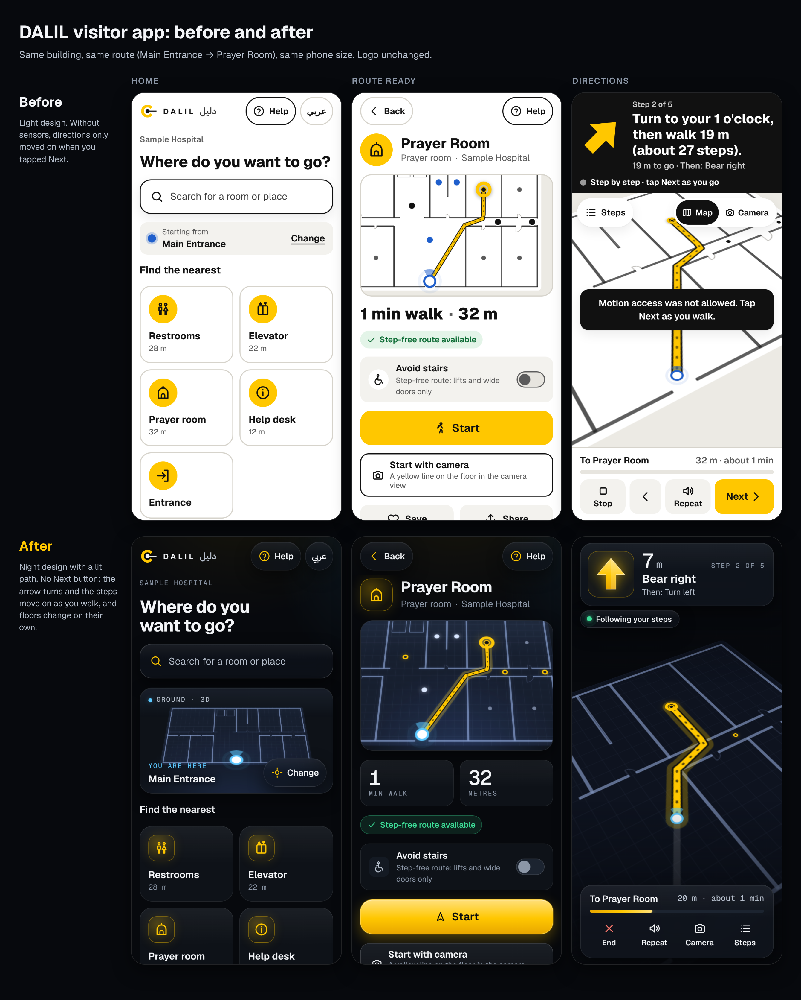

# DALIL visitor app: redesign 3, "Lit path" (November 2026)

What the founder said about redesign 2:
- "I hate this feature of clicking next, remove it."
- "I want the arrow to move when the person moves."
- "The design is mid. I want a polished, futuristic design."

The earlier asks still apply: simple for every age, big targets, honest, the logo unchanged.

## 1. Audit of redesign 2 ("Follow the yellow line", light)

| # | Problem | Who it hurt |
|---|---|---|
| 1 | **Directions moved on with taps.** Without sensors (or before they were trusted) the guidance was "tap Next as you go", with Stop · Back · Repeat · Next in the footer. | Everyone: it felt like flicking through a list, not being guided. |
| 2 | **More taps on the way:** "Yes, I'm at …" on sign steps, and "I'm on Level 2 now" after every lift or stair. | Anyone with full hands, a child, a cane or a wheelchair. |
| 3 | **Flat white screens.** Plain forms with no depth, so the app looked generic rather than like a navigation product. | DALIL's pitch to institutions. |
| 4 | **A flat map.** The floor plan was a line drawing, with no sense of "you are here, the path goes there". | Visitors who don't read plans. |
| 5 | **The sign repeated the step text.** It showed long instructions ("Turn to your 1 o'clock, then walk 19 m (about 27 steps).") instead of one short action and a countdown. | Readers in a hurry, older eyes. |
| 6 | **Kiosk and no-sensor desktops** fell back to the same tap-to-advance screen. | Kiosk visitors, demos. |

## 2. Concept

The phone becomes a **heads-up display**. The building is a holographic 3D floor plan, the route is a lit yellow path
(DALIL yellow #FFC700, unchanged), and you are a cyan beacon. Glass panels float over the map:
- the top panel shows **what to do next and how far** ("8 m · Bear right · Then: Turn left"), with an arrow that
  turns as you turn;
- the bottom panel shows **where you are going** and offers four plain controls: **End · Repeat · Camera · Steps**.

There is **no Next button and no manual stepping**. The arrow and the steps follow your body:
- the compass turns the arrow;
- each step moves you along the route;
- turns are announced before you reach them;
- floors change on their own (see 5).

Kept from redesign 2:
- one job per screen;
- a Back button on every page;
- words on every control;
- 56–68 px buttons;
- three text sizes;
- Help everywhere;
- honest status.

## 3. Design system (`app/styles.css`)

| Tokens | Values |
|---|---|
| Brand | `--brand #FFC700` (gradient to `#FFE07A` / `#E9A800` on primary buttons), `--on-brand #0B0D10` |
| You | `--you #5CC8FF` (Night), `#0A6CD6` (Day): the beacon and "you are here" |
| Night (default) | bg `#07090D`, layers `#0E1218` / `#141A23` / `#1C2430`, glass `rgba(16,21,29,.62)` with a hairline highlight, ink `#F3F5F8` / `#B7C0CD` / `#8C97A7` |
| Day | bg `#EEF1F5`, white glass, ink `#0B0F16` / `#364152` / `#536073`: for bright corridors and people who prefer it |
| High contrast | black, white and yellow `#FFE600` only; no glass, no glow; white borders on every control |
| Map | walls `rgba(176,202,255,.66)`, floor tint, a 2 m grid, route with a soft glow, walked part dimmed |
| Status | ok `#3DDC97`, warn `#FF7A6E` (Night); `#0B7A45`, `#B42318` (Day) |
| Type | Geist (Latin), **Geist Mono for numbers** (distances, step counters), IBM Plex Sans Arabic (Arabic); body 1.125 rem; root 100 / 118.75 / 137.5 % |
| Touch | `--tap` 3.5 rem (56 px), `--tap-lg` 4.25 rem (68 px); nothing under 48 px (tested) |
| Shape | radius 18 px (rows, buttons), 24 px (cards, panels), pills for small top buttons |
| Motion | page rise-in, beacon pulse, flowing route dashes, arrow turns smoothly; **all off with Reduce motion** (Settings or the phone's setting) |

Fonts are bundled in `app/fonts/` (SIL Open Font License, licence files next to them) and cached for offline use.
The logo (SVG mark, "DALIL" and the Arabic wordmark in its own subset font) is unchanged.

## 4. Screens

1. **Home**:
   - building name and "Where do you want to go?";
   - search;
   - a **3D hologram of your floor** with "You are here · Main Entrance" and Change (tap it for the floor map);
   - tiles for the building's essentials, with the walk to the nearest;
   - saved and recent places, Getting here, Scan a DALIL sign, Settings.
2. **Search**: full screen, big rows with the distance in mono figures, filters, results grouped by floor, recent
   searches, and a real empty state.
3. **Route ready**:
   - place name and a tilted 3D route map;
   - two big figures: **minutes** and **metres**;
   - "By lift to Level 2" when it changes floor, plus facts;
   - the **Avoid stairs** switch;
   - **Start** and **Start with camera**;
   - Save, Share, and all steps.
4. **Directions (HUD)**:
   - top panel:
     - the arrow tile;
     - a countdown ("8 m") or "Now" at the turn;
     - the action;
     - "Then: …";
     - "Step 2 of 5";
   - status pill below it;
   - full-screen 3D map or camera;
   - bottom panel: destination, metres and minutes left, progress, and **End · Repeat · Camera · Steps**.
5. **Floor change card**:
   - lift: "Take the lift up to Level 2 · Step out at Level 2. The arrow carries on when you walk out.";
   - stairs: "18 of about 20 steps" with a meter.
6. **Motion card**, shown only if motion is unavailable. It says why and offers:
   - **Allow motion**;
   - **Watch a preview**;
   - **Continue with signs only**.
7. **Arrived**: animated check, place, distance and time, Done, Save this place.
8. **Where are you?**: scan the QR on a DALIL sign, hold the phone on its NFC tag (Android), or pick from a list.
9. **Floor map**: every floor, tap a place for directions, drop a pin or save "My spot".
10. **Settings**:
    - language;
    - text size;
    - look (**Night** / Day / Same as phone), high contrast, reduce motion;
    - directions: voice, vibration, always avoid stairs, walking pace;
    - building and street map;
    - about.
11. **Getting here** and **Help**, unchanged from redesign 2.

## 5. Moving with you, with no taps (details: `motion-and-camera.md`)

- **Start** asks for motion access inside the tap (iPhone needs that) and starts following.
  - **While walking**:
    - the compass turns the arrow;
    - each step moves you along the route;
    - the top panel counts down to the next turn;
    - "In 5 m: Turn left" is spoken and buzzed before the turn;
    - three steps the wrong way says "Wrong way · turn around".
  - **Corrections**: corners and DALIL signs correct the position. Passing a sign needs no tap; scanning or tapping
    one confirms where you are, and a sign off the route re-plans from there.
- **Floors change automatically**:
  - **Lift**: the accelerometer feels the ride start and stop. When you walk out, the next floor's directions begin.
    If the ride isn't felt, walking again after a pause of over 20 s, or 15 steps, also counts.
  - **Stairs**: the app counts about 20 steps per floor ("18 of about 20 steps"), then moves on.
  - A DALIL sign at the lift lobby or stair door makes it exact.
- **No motion** (permission refused, a computer, or the preview frame on claude.ai): nothing moves on by itself, and
  the app says so. The motion card offers:
  - **Allow motion** again;
  - **Watch a preview** (a simulated walk, always labelled "Preview · not your real position");
  - **Continue with signs only**, where the position moves only at DALIL signs.
- **Kiosk**: Start becomes **Watch the route** (a labelled preview) and a QR code to continue on a phone.
- **Status pill** (never pretends):
  - "Starting sensors…";
  - "Walk a few steps to line up the arrow";
  - "Following your steps";
  - "Hold the phone in front of you and walk";
  - "Wrong way · turn around";
  - "Changing floor";
  - "Motion is off";
  - "Preview · not your real position".

## 6. Camera

"Start with camera" or Camera in the HUD opens the rear camera:
- **The guide line**:
  - a yellow ribbon on the floor, with arrows gliding forward;
  - the destination as a ring and a named post;
  - the name stays clear of the panels;
  - "The line is to your left / right" or "Turn around to see the line" when it's out of view.
- **Without motion** the camera still opens to read DALIL sign QR codes. It says the guide line needs motion.

## 7. Code

- `tracker.js` gained lift-ride detection (`liftEvents`, `onLift`) and `prevStep`.
- `app.js`:
  - the navigation section is rewritten (motion-driven steps, `floorStep` / `advanceFloor`, motion card, HUD
    countdown `hudState`);
  - `startNav({ camera, preview })`;
  - settings v3 (Night default; v2 settings migrate).
- `mapview.js` gained the grid pattern, the route glow and tilt-aware fitting.
- `camera.js` keeps labels clear of the panels.
- `index.html`, `styles.css` and the HUD strings in `i18n.js` are new.
- Removed: Next, Back-a-step, "I'm at …", "I'm on Level 2 now", the steps mode, the Sensors switch, jumping to a
  step from the list.

## 8. Testing

- `npm test`: **23/23 pass**, including:
  - a whole route walked with simulated sensors and **no Next button anywhere**;
  - the arrow learning the compass, countdown, heads-up and wrong way;
  - motion off (the card, signs only, labelled preview);
  - passing a sign with no tap;
  - camera line (Chromium's fake camera);
  - camera without motion;
  - QR sign scanning and re-routing;
  - **Kennedy Library up the stairs and by lift with automatic floor change**;
  - Arabic;
  - kiosk preview;
  - 48 px targets and AA contrast in Night and Day;
  - offline, including the new fonts;
  - and the earlier checks.
- `tests/test_mapper.py`: Mapper unchanged.
- Checked by screenshot:
  - Night, Day and high contrast;
  - English and Arabic (RTL; markers stay on the map; Arabic is never letter-spaced);
  - 320 px (iPhone SE), 360 px with extra-large text, 412 px phones and 1280 px desktop.
- **Not verified here (needs real phones in a real building):**
  - compass and step counting on real phones;
  - **lift-ride detection** (phones and lifts differ);
  - stair step counts;
  - camera field of view;
  - iPhone motion permission;
  - VoiceOver and TalkBack;
  - real street tiles.

  **Known limit: wheelchair users.** Pushing a wheelchair gives few detectable steps, and there is no manual stepping
  any more, so their position moves on at DALIL signs. Put signs at every decision point on step-free routes.

  Field protocol: `motion-and-camera.md`.

## History

- Redesign 1 (November 2026, `redesign-before-after.png`): dark, map-first, one bottom sheet.
- Redesign 2 (November 2026, `redesign-2-before-after.png`): light, "Follow the yellow line", camera line, map
  providers, help, institution config.

Redesign 3 keeps all of redesign 2's features and removes its tapping.
