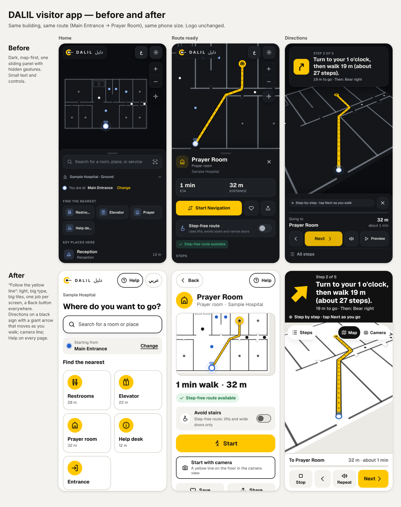

# DALIL visitor app: redesign 2, "Follow the yellow line" (November 2026)

Founder feedback on redesign 1: didn't like how it looked, how it worked or how it was designed. Wanted it simple
and straightforward for every age, an arrow that moves when you move, a camera view with a guide line to follow,
many map providers, and a product an institution would actually buy.

## 1. Audit of redesign 1 ("the lit path", dark, map-first)

| # | Problem | Who it hurt |
|---|---|---|
| 1 | **Hidden gestures.** Everything lived in one bottom sheet you had to drag (peek / half / full). | Older visitors and first-timers: nothing says "drag me". |
| 2 | **Map first.** A full-screen floor plan with small controls on top. Plans are hard to read for many people. | Anyone who doesn't read maps. |
| 3 | **Dark by default**, small type (14–16 px), grey-on-graphite secondary text. | Low vision, bright corridors, older eyes. |
| 4 | **Icon-only controls**: a gear, "ع", +/−, a crosshair. | People who don't know the icons. |
| 5 | **The arrow never moved.** Directions advanced only with "Next"; the phone's compass and step counter were unused. | Everyone: it felt like a list, not guidance. |
| 6 | **No camera help** for people who can't relate a plan to the corridor in front of them. | Visitors who are lost. |
| 7 | **No way to ask for help** in the app, and no way to re-locate except NFC (no NFC on iPhone web). | Lost visitors; iPhone users. |
| 8 | **One street map provider**, hard-coded. | Institutions (no choice, no failover). |
| 9 | **Toasts covered the main buttons** during navigation. | Everyone mid-route. |
| 10 | **Not a product an institution can configure**: no help number, no usage counts, no per-site settings. | DALIL's customers. |

## 2. Concept

Hospitals paint coloured lines on the floor so people can follow them without reading a map. DALIL does the same
with its own safety yellow (#FFC700, unchanged): **the yellow line is the route**, on the map, on the floor in the
camera view, and as the giant arrow on a black sign. Everything else is plain black text on white.

Rules that follow from it:
- **One job per screen**, a big **Back** button on every page, the phone's back button works, no hidden gestures.
- **Words with icons.** Every important control has a label ("Help", "Start", "Stop", "Repeat", "Next").
- **Big by default**: 18 px body, 26–30 px headings, 56–68 px buttons, three text sizes (Normal / Large /
  Extra large); everything is in `rem`, so buttons grow with the words.
- **Directions always look like a sign**: black panel, giant yellow arrow, one sentence, "N m to go · Then: …".
- **Honest**: the status line says what the guidance is based on (see 5).
- **The logo is never changed** (same SVG and wordmark as before).

## 3. Design system (`app/styles.css`)

| Tokens | Values |
|---|---|
| Brand | `--brand #FFC700`, `--on-brand #111111` (12.6:1) |
| Light (default) | bg `#FFFFFF`, bg-2 `#F3F2EE`, line `#D6D3CB`, ink `#111111` / `#3B3B3B` / `#5C5C5C` (≥ 6:1 on white) |
| Dark | bg `#111214`, bg-2 `#1B1D20`, ink `#F3F3F1` / `#D4D4D0` / `#A9A9A4` |
| High contrast | black, white and yellow `#FFE600` only, white borders on every control |
| Sign | `#111111` (light) / `#000000` (dark), white text, yellow arrow |
| Status | ok `#0B6B33`, warn `#A61B1B`, info `#1F5FCC` (light); `#57D68B` / `#FF8A80` / `#8DB6FF` (dark) |
| Type | Geist (Latin), system Arabic; body 1.125 rem; titles 1.75–1.875 rem; sign 1.625 rem; root 100 / 118.75 / 137.5 % |
| Touch | `--tap` 3.5 rem (56 px), `--tap-lg` 4.25 rem (68 px); nothing under 48 px (tested) |
| Shape | radius 16 px (buttons, rows), 22 px (tiles, cards), pills for top-bar buttons |
| Motion | 0.22 s page fade, arrow turns smoothly; all off with Reduce motion |

Components: top bar (logo, Help, language), search button, "Starting from" card, tiles, list rows, chips, route
map card, big stat line, fact chips, switch rows, primary / secondary / tertiary buttons, step list, sign panel,
status line, Map / Camera switch, footer controls, arrival card, bottom-sheet dialogs (Steps, Help, Share), toast.

## 4. Screens

1. **Home**: building name, "Where do you want to go?", a big search button, "Starting from … Change", up to six
   **tiles** for what this building has (Restrooms, Elevator, Prayer room, Café, Help desk, Entrance, Baby care,
   Stairs) with the walk to the nearest, Saved places, Recent, then Floor map, Getting here, Scan a DALIL sign, Settings.
2. **Search**: full screen, big rows with distance, filters, results grouped by floor, recent searches, a real empty state.
3. **Route ready**: place, map of the route, "4 min walk · 120 m", "By lift to Level 2", facts (room, step-free or
   not), **Avoid stairs** switch, **Start**, **Start with camera**, Save, Share, all steps.
4. **Directions**: the sign (giant arrow, step, "N m to go · Then: …", status line), Map or Camera view, destination
   and progress, **Stop · Back · Repeat · Next**; "Yes, I'm at …" on tag steps; "I'm on Level 2 now" on floor changes.
   On small phones with big text the four controls become three (the Steps list jumps to any step).
5. **Arrived**: big check, place, time and distance, Done, Save this place.
6. **Where are you?**: scan the code on a DALIL sign (camera), hold the phone on the NFC tag (Android), or choose from a list.
7. **Floor map**: every floor, tap a place for directions, tap the floor to drop a pin or save "My spot".
8. **Settings**: language, text size, look (light / dark / same as phone, high contrast, reduce motion), directions
   (voice, vibration, always avoid stairs, motion sensors, walking pace), building map and street map, about
   (not for emergencies; privacy).
9. **Getting here**: the building on a street map from the provider list, with failover, Google / Apple Maps links.
10. **Help** (on every page): call the building (only if it gave a number), take me to the help desk, scan a sign,
    and a card to show staff, in English and Arabic.

## 5. The moving arrow and the camera line (details: `motion-and-camera.md`)

- **Moving arrow**: on Start the app asks for motion access (iPhone asks in that tap). The compass turns the arrow
  toward the route; each step moves you along it; turns are announced 5–6 m ahead; walking away for three steps
  says "Wrong way · turn around"; corners and DALIL signs correct the position.
- **Camera**: the rear camera with the route drawn as a yellow ribbon on the floor, arrows gliding forward, the
  destination as a ring and a named post; "Turn around to see the line" when it is behind you. The camera also
  reads DALIL sign QR codes: on the route it confirms where you are, elsewhere it plans a new route from there.
- **Status line** (never pretends): "Following your steps" (sensors), "Walk a few steps to line up the arrow"
  (learning the compass), "Wrong way · turn around", "Step by step · tap Next as you go" (no sensors),
  "Preview · not your real position" (simulated walk, only from the Steps list).

## 6. For institutions

`app/config.json` per site (see `institution-setup.md`): name, help phone, map providers and keys, an optional
endpoint for anonymous usage counts (off by default), camera / motion switches. Plus what was already there:
QR / NFC tag links, share links for appointment messages, kiosk mode, closures, offline use.

## 7. Code

New modules: `tracker.js` (sensors, steps, route matching), `camera.js` (guide line, QR reading),
`providers.js` (map providers, failover), `config.json`, `vendor/jsqr/` (QR decoding where the browser has no
BarcodeDetector, e.g. iPhone; Apache-2.0). Rewritten: `index.html`, `styles.css`, the UI half of `app.js`,
`i18n.js`. Kept: routing, multi-floor plans, deep links, NFC, share + QR, kiosk, offline, voice, vibration.

## 8. Testing

- `npm test`: **21/21 pass**. The previous 14 checks are kept, moved to the new pages. New checks:
  - motion tracking: the arrow learns the compass angle from the walk and follows the steps; heads-up before turns; wrong-way warning; calibration kept for next time;
  - camera guide line, using Chromium's fake camera;
  - camera mode without sensors explains and falls back;
  - QR sign scanning, using a generated camera video: it sets the location, and an off-route sign re-plans;
  - help without and with a phone number;
  - anonymous usage counts;
  - provider failover (OpenFreeMap → VersaTiles → plain, and Mapbox → VersaTiles);
  - 48 px targets and AA contrast on Home, Route and Directions;
  - phone back button;
  - extra-large text.
- `tests/test_mapper.py`: passes.
- Checked by screenshot: 320, 360, 390, 412 px phones and 1280 px desktop; light, dark, high contrast; English and
  Arabic; normal, large and extra-large text; no button off-screen and no sideways scrolling.
- **Not verified here (needs a real phone in a real building):**
  - real compass and accelerometer readings, which vary by phone, grip and steel in the building;
  - real camera field of view;
  - iPhone motion permission;
  - VoiceOver and TalkBack;
  - real street tiles (this environment blocks the tile servers; failover was tested with stand-ins).

  Field test protocol: `motion-and-camera.md`.

## History

Redesign 1 (also November 2026, `redesign-before-after.png`) made the app map-first with one bottom sheet and an
honest mode badge. Kept from it: honest labelling, recents and saved places, floor browsing that never moves you,
bidi-safe names, boot and retry screen, kiosk and share.
