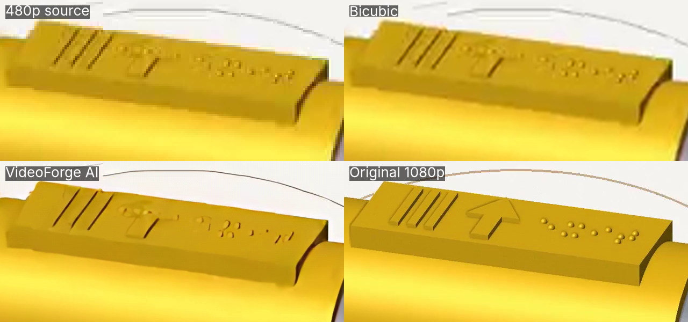
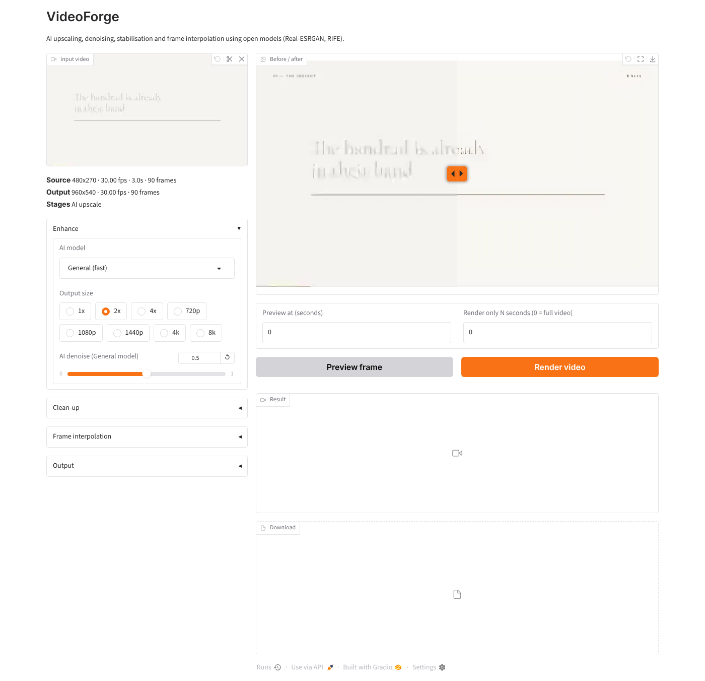

# VideoForge

An open-source AI video enhancer covering the core jobs of commercial tools like
Topaz Video AI: **upscaling, AI denoise, temporal denoise, deflicker,
stabilisation, frame-rate conversion and slow motion**. It comes with a
command-line tool and a local web UI.

VideoForge contains no Topaz code or models. It runs openly licensed research
models through architecture code written for this project:

| Stage | Model | Licence |
|---|---|---|
| Upscale: *General* | Real-ESRGAN `realesr-general-x4v3`, blended with its weak-denoise twin for a denoise slider | BSD-3 |
| Upscale: *Animation* | Real-ESRGAN `realesr-animevideov3` | BSD-3 |
| Upscale: *High quality* | Real-ESRGAN `RealESRGAN_x4plus` (RRDB) | BSD-3 |
| Frame interpolation | RIFE v4.7 (arbitrary timestep, so any fps works) | MIT |
| Temporal denoise / deflicker / stabilise | ffmpeg `hqdn3d`, `deflicker`, `vid.stab` | LGPL/GPL |

Weights download on first use to `~/.cache/videoforge`. You can change the
location with `VIDEOFORGE_CACHE`.



*A 1080p clip shrunk to a heavily compressed 480×270, then restored to 1080p.
VideoForge removes the blocking and sharpens edges, scoring 32.8 dB PSNR
against the original versus 31.5 dB for bicubic. Detail that never reached
480p, such as the braille dots, cannot be recovered.*



## Try it in your browser (free GPU)

[](https://colab.research.google.com/github/ahmednizarrs/ahmed/blob/claude/vercel-labs-agent-skills-2lgsxj/videoforge/VideoForge.ipynb)

Choose **Runtime → Change runtime type → T4 GPU**, then **Run all**, and open
the `gradio.live` link it prints.

## Install

```bash
# ffmpeg must be on PATH (apt install ffmpeg / brew install ffmpeg)
pip install -r requirements.txt
# NVIDIA GPU: install the CUDA build of torch from https://pytorch.org first
```

## Command line

```bash
python -m videoforge clip.mp4 --scale 2                       # 2x upscale, keeps audio
python -m videoforge clip.mp4 --res 4k --model quality --sharpen 0.4
python -m videoforge clip.mp4 --model none --fps 60           # 24/30 -> 60 fps only
python -m videoforge clip.mp4 --model none --slowmo 4         # 4x slow motion
python -m videoforge old.mp4 --res 1080p --pre-denoise 0.6 --deflicker --stabilize
python -m videoforge clip.mp4 --scale 2 --start 10 --duration 3   # quick 3 s test
python -m videoforge clip.mp4 --res 4k --dry-run              # show plan only
```

Run `python -m videoforge -h` to see every option (codec `h264|h265|prores`,
`--crf`, `--grain`, `--scene-threshold`, `--device`, `--tile`).

## Web UI

```bash
python app.py            # http://127.0.0.1:7860
```

Upload a clip and choose a model, output size and options. **Preview frame**
shows a before/after slider for one frame. **Render video** processes the whole
clip, or only N seconds starting at the preview time.

## How it works

```
ffmpeg decode ─► stabilise / deflicker / hqdn3d ─► RIFE (new in-between frames)
     ─► Real-ESRGAN x4 (tiled) ─► resize to target ─► sharpen / grain ─► ffmpeg encode (+ audio)
```

* **Interpolation runs before upscaling.** Optical flow is estimated at source
  resolution, which is much cheaper, and every output frame then goes through
  the same upscaler.
* **Timeline maths.** Output frame *j* maps to source position
  `j · fps_in / (fps_out · slowmo)`. Whole-number positions reuse source
  frames. Fractional positions are passed to RIFE with that exact timestep, so
  conversions like 23.976 → 60 or 25 → 30 work as well as clean 2x.
* **Scene cuts.** A cheap thumbnail-difference check stops RIFE from blending
  across hard cuts. The nearest frame is duplicated instead.
* **Tiling.** Frames are split into overlapping 384 px tiles so 4K output fits
  in modest VRAM or RAM.

## Speed and limits

* On a GPU, the *General* and *Animation* models run in near real time at
  720p→1440p. On CPU, expect roughly 0.2–1 frames per second at SD/720p input,
  so use `--duration` for tests.
* The upscalers work one frame at a time. Topaz's video models
  (Proteus/Artemis/Iris) look at neighbouring frames, which reduces
  frame-to-frame shimmer. To get closer, enable **Temporal denoise** at 0.3–0.5,
  which smooths flicker before the upscale.
* No face-specific restoration is included yet. GFPGAN or CodeFormer could be
  added as an extra stage.

## Test

```bash
python tests/smoke_test.py
```

The test checks that every checkpoint loads with strict key matching, that RIFE
beats a naive blend on a moving pattern, and that a full 24→60 fps 2x upscale
with audio produces a valid file.
